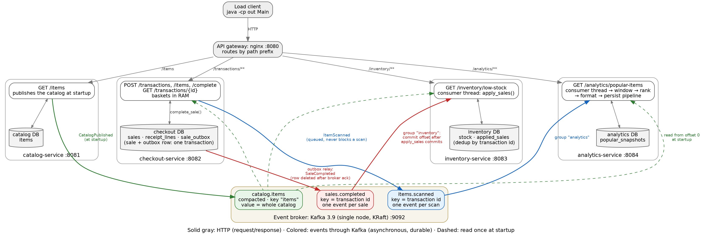

# Event-driven self-checkout server

C++20 / Drogon 1.8 / Postgres 18 / **Kafka 3.9** (librdkafka 2.3). It has the same four microservices
and API contract as `microservices/` (week 5), but the services no longer call each other at all.
Every message between services is an event on a Kafka topic. HTTP is left only between the load
client, the gateway and a service. Prereqs: `libdrogon-dev`, `librdkafka-dev`, `catch2`, `cmake`,
`ninja-build`, `docker`, `psql`.



`docs/architecture.dot` is the source; it also renders to `docs/architecture.svg`.

## Services

| Service | Executable | Port | Public routes (via gateway) | Publishes | Consumes | Own database: tables |
|---|---|---|---|---|---|---|
| **Catalog** | `catalog-service` | 8081 | `GET /items` | `catalog.items` | — | `catalog`: `items` |
| **Checkout** | `checkout-service` | 8082 | `POST /transactions`, `POST /transactions/{id}/items`, `POST /transactions/{id}/complete`, `GET /transactions/{id}` | `sales.completed`, `items.scanned` | `catalog.items` | `checkout`: `sales`, `receipt_lines`, `sale_outbox` |
| **Inventory** | `inventory-service` | 8083 | `GET /inventory/low-stock` | — | `catalog.items`, `sales.completed` | `inventory`: `stock`, `applied_sales` |
| **Analytics** | `analytics-service` | 8084 | `GET /analytics/popular-items` | — | `catalog.items`, `items.scanned` | `analytics`: `popular_snapshots` |

**API gateway**: nginx (`gateway/nginx.conf`, compose service `gateway`, container `events-gateway`) on
:8080 routes public paths by prefix, so the load client still sees one base URL. Week 5's internal
`/events/*` HTTP routes are gone.

**Event broker**: Kafka 3.9.1 (compose service `broker`, container `kafka`). It runs as a single node in
KRaft mode, so there is no ZooKeeper, and it listens on `localhost:9092`. Each service's config file
(`config/<service>.json`) names its own database and `kafka_brokers`, and nothing else.

## Events

All event contracts live in one file, `src/events.hpp`. The Kafka client wrapper is
`src/bus/bus.{hpp,cpp}`: a `Producer`, a `Consumer` and `latestEvent`. Values are compact JSON.

| Topic | Event | Key | Producer | Consumer | Replaces (week 5) |
|---|---|---|---|---|---|
| `catalog.items` (compacted) | the whole catalog (`{"items": [...]}`) | `"items"` | catalog, at startup | checkout, inventory, analytics: read from offset 0 at startup | `GET /items` from each service |
| `sales.completed` | `{"transactionId", "lines": [{sku, quantity}]}` | transaction id | checkout's outbox relay | group `inventory` | `POST /events/sales` |
| `items.scanned` | `{"transactionId", "sku"}` | transaction id | checkout's scan handler | group `analytics` | `POST /events/scans` |

- **Catalog = event-carried state.** Catalog publishes its items once at startup. The topic is
  *compacted*, so Kafka keeps the newest value per key indefinitely. A service that starts later reads
  the topic from the beginning to its end and keeps the last value (`fetchCatalog`). Start order no
  longer matters, and catalog does not need to be up for the others to keep running.
- **Consumer groups** store their offset (how far they have read) in Kafka. A consumer commits only
  after it has handled a batch. If inventory or analytics restarts, it resumes where it left off, and
  events published while it was down wait in the topic.
- **One partition per topic**: each topic has one consumer. Analytics' windows count scans in arrival
  order, as in every earlier week. Scaling a consumer out would mean adding partitions plus more
  members in the same group. Keying by transaction id would keep each basket's events in one
  partition, in order.

## Completing a sale: an update to two databases

`POST /transactions/{id}/complete` records the sale in checkout's database. The stock decrement in
inventory's database follows through Kafka:

1. **Checkout, one local transaction.** `complete_sale()` (`db/checkout.sql`) inserts the `sales` row,
   its `receipt_lines` and one `sale_outbox` row in a single commit. The HTTP response is sent after that
   commit.
2. **Outbox relay (thread in checkout).** It reads up to 1,000 pending outbox rows and publishes one
   `sales.completed` event per sale. It waits for the broker to acknowledge them (`acks=all`, idempotent
   producer), then deletes those rows. If the broker is down, the rows stay and the relay retries every
   200 ms. Publishing straight from the request handler would lose the event whenever the process
   died between the DB commit and the publish; the outbox closes that gap.
3. **Inventory, consumer group `inventory`.** It polls up to 1,000 events and calls `apply_sales()`
   (`db/inventory.sql`) once for the batch, then commits the offset. `apply_sales` inserts each
   transaction id into `applied_sales ... ON CONFLICT DO NOTHING` and decrements stock only for the
   new ones. Two failure cases are covered:
   - The relay resends after a lost acknowledgement: `applied_sales` skips the sales already applied.
   - Inventory crashes between applying and committing: Kafka redelivers the batch, and again
     `applied_sales` skips the repeats.

   Delivery is at least once and the effect is exactly once.

Stock is *eventually* consistent with sales. In the smoke test, the low-stock report trails a
completion by about 0.25 s. `scripts/verify.sh` waits until the outbox is empty and
`applied_sales` = `sales`. It then requires, for every SKU, `initial − quantity = LEAST(units on
checkout's receipts, initial)`.

Scans take a simpler path. The scan handler queues an `items.scanned` event in librdkafka's
in-memory buffer and returns. librdkafka batches the queued events to the broker every 5 ms, so a
scan never waits for the broker or for analytics.

## Results

| Run | Week 5 (HTTP between services) | Week 6 (this, Kafka) | Report |
|---|---|---|---|
| default, 10 stations / 60 s | 1,734.8 tx/s, complete p99 4.8 ms | **1,689.3 tx/s**, complete p99 5.3 ms | `reports/report-20261101-154125.json` |
| stress, 100 stations / 120 s | 3,204.7 tx/s, complete p99 24.0 ms | **2,982.7 tx/s**, complete p99 26.6 ms | `reports/report-20261101-154354.json` |

Both runs had 0 errors and INVARIANT OK, and every sale was applied by inventory (101,386 and
358,011). Analytics kept up with every scan: 2,124 snapshots = ⌊1,062,221 scans / 500⌋ and
7,526 = ⌊3,763,212 / 500⌋.

Throughput is within 3 % of week 5 on the default run and 7 % lower under stress. That is expected,
because completion still commits to checkout's database only. Possible causes of the stress gap, not
profiled: the broker is a JVM sharing the laptop's CPU with the services, and every scan is now its
own Kafka event (31k/s) instead of a batched POST.

## Run it

```bash
docker start checkout-db                                      # Postgres on :5432 (container from earlier weeks)
docker compose up -d broker gateway                           # Kafka on :9092, nginx on :8080 (stop ms-gateway first)
db/reset.sh && broker/reset.sh                                # fresh databases + empty topics
cmake --preset release && cmake --build --preset release      # -> build/release/{catalog,checkout,inventory,analytics}-service
./build/release/catalog-service config/catalog.json           # likewise checkout, inventory, analytics; any start order
scripts/run-test.sh [--stations=100 --duration=120]           # all of the above -> load client -> verify.sh
```

Tests: `ctest --preset release -L unit` (no DB) · `-L db` (needs Postgres) · `-L bus` (needs Kafka) ·
`tests/smoke.sh` (every endpoint through the gateway).

Looking inside the broker (each command runs a Kafka CLI tool inside the container):

```bash
docker exec kafka /opt/kafka/bin/kafka-topics.sh --bootstrap-server localhost:9092 --describe              # topics, partitions, configs
docker exec kafka /opt/kafka/bin/kafka-consumer-groups.sh --bootstrap-server localhost:9092 --describe --group inventory   # offset vs end = lag
docker exec kafka /opt/kafka/bin/kafka-console-consumer.sh --bootstrap-server localhost:9092 --topic sales.completed --from-beginning --max-messages 3   # read 3 events
```
